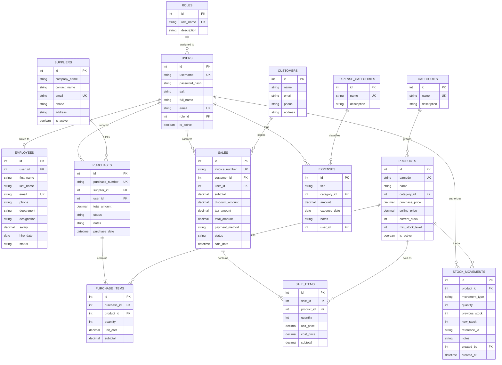

# INVENTORY AND BUSINESS MANAGEMENT SYSTEM
**Enterprise Java & MySQL JDBC ERP Application (Console & Modern Swing GUI)**  
*College Semester Capstone Project / Viva Demonstration Ready*

---

## 1. Project Abstract
The **Inventory and Business Management System** is an enterprise-grade business operations software engineered in Core Java using MySQL 8.x and JDBC. Designed to mirror real-world Enterprise Resource Planning (ERP) workflows, the system streamlines and centralizes the administration of products, suppliers, customers, procurement purchase orders, retail checkout sales transactions, stock movement audit trails, human resource records, operating expenses, and financial reporting.

The application features dual interfaces:
1. **Modern Desktop Graphical User Interface (Swing GUI):** A sleek, professional desktop app with an executive dashboard, responsive navigation sidebar, modal dialogs, and real-time transaction processing (`ui.SwingApp`).
2. **Interactive Menu-Driven Console Interface:** A clean, zero-crash CLI experience with structured ASCII tables, banners, and real-time validation (`main.Main`).

The application implements a layered architecture separating concerns across configuration, domain models, data access objects (DAO), transactional business service layers, cryptographic security routines (`PBKDF2WithHmacSHA256`), and user presentation. Through atomic database transaction management (`setAutoCommit(false)`, `commit()`, and `rollback()`), the system guarantees strict database integrity, ensuring stock levels can never become negative, financial calculations align across purchase costs and retail margins, and operational cancellations restore inventories safely without double-restoration.

---

## 2. Key Technical Improvements & Verification

The system has undergone a rigorous technical audit and correction process to ensure enterprise-grade security, mathematical accuracy in financial reports, and resilient database transaction handling:

1. **Cryptographic Password Upgrade (PBKDF2WithHmacSHA256):**
   - Replaced legacy SHA-256 with `PBKDF2WithHmacSHA256` using 65,536 iterations, 256-bit key length, and 16-byte cryptographically secure random salt.
2. **Plaintext Fallback Removed:**
   - Strict rejection of unhashed or plaintext passwords in authentication.
3. **Transparent Legacy Account Migration:**
   - Existing accounts with legacy SHA-256 hashes are automatically verified and upgraded in-place to PBKDF2 during their next successful login without user lockout.
4. **P&L Fan-Out Aggregation Bug Resolved:**
   - Re-engineered `ReportDAO.getProfitAndLossReport()` to compute sales header aggregates (`gross_sales`, `discounts`, `net_revenue`, `taxes`) independently from `sale_items`. This prevents multi-item invoices from duplicating invoice-level numbers.
5. **Independent Financial Calculations:**
   - Gross sales, discounts, and net revenue are calculated independently from Cost of Goods Sold (COGS).
6. **COGS Computed from Completed Sale Items Only:**
   - Filtered exclusively by `s.status = 'COMPLETED'` to avoid factoring cancelled or voided transactions.
7. **Consistent Financial Definitions Across Dashboard & Reports:**
   - Aligned metric formulas in `ReportDAO.getDashboardMetrics()` to use the exact same financial rules: `Gross Sales - Discounts = Net Revenue; Net Revenue - COGS = Gross Profit; Gross Profit - Expenses = Net Profit`.
8. **Secure Database Credentials Management:**
   - Passwords and database endpoints are decoupled from version control. `DBConnection` loads credentials with priority: `Environment Variables (DB_URL, DB_USER, DB_PASSWORD)` -> Untracked `database.local.properties` -> Default template.
9. **Non-Destructive Application Startup:**
   - Strict protection preventing destructive `DROP DATABASE` or `DROP TABLE` operations on startup. Existing inventory and business records are preserved.
10. **Atomic Transaction Handling in DAOs:**
    - Verified strict `setAutoCommit(false)`, rollback on exception, and proper resource management across `SalesDAO`, `PurchaseDAO`, and `InventoryDAO`.
11. **Double Stock Restoration Prevention:**
    - Order cancellation in `SalesDAO` and `PurchaseDAO` uses atomic conditional state transitions (`WHERE id = ? AND status = 'COMPLETED'`) before adjusting inventory. Attempting to cancel an invoice twice is rejected.
12. **Comprehensive Automated Test Suites:**
    - Added unit and financial integration tests verifying multi-product invoices, discounts, sales taxes, COGS, net profit, cancellation stock restorations, and live MySQL database rollback integrity.

---

## 3. Dual Interface Options

### A. Modern Java Swing Desktop GUI (`ui.SwingApp`)
- **Launch Command:** `run-gui.bat` or `run-gui.ps1`
- **Design System:** Custom theme with modern palette (`#0F172A` Slate Dark, `#2563EB` Royal Blue, `#10B981` Emerald Green, `#EF4444` Crimson Red), high-DPI subpixel anti-aliased typography, and card-based modular layouts.
- **Components:**
  - **Login Dialog:** Authentication card with instant demo credential fill buttons (`admin` / `staff`).
  - **Left Sidebar Navigation:** Fixed 250px panel displaying current user profile badge (Name & Role), 11 module switches, Change Password modal, and Log Out action.
  - **Executive Dashboard:** 8 real-time KPI cards (Catalog size, stock units, low-stock alerts, today's sales, month revenue, expenses, net profit) and a live transaction feed.
  - **POS & Sales Counter:** Point-of-Sale screen with live product selector, available stock indicators, shopping cart table, discount %, tax %, total calculations, receipt preview/export, and sales invoice history with cancellation.
  - **Product Catalog Management:** Data table with real-time text search, category filtering, stock health badges (Healthy / Low Stock / Out of Stock), and Add/Edit/Delete modals.
  - **Category Hierarchy:** Add, edit, and organize product categories with safety guards against deleting categories that contain active products.
  - **Purchases & Procurement:** Create multi-item purchase orders with supplier selection, stock incrementation, receipt generation, and safe cancellation with stock rollback.
  - **Inventory & Movement Audits:** Valuation summary cards (Cost Value, Retail Value, Potential Profit), current stock snapshot, immutable movement audit trail, and manual stock adjustment modal with justification notes.
  - **Customer Directory:** Manage customer records, view complete purchase history with order dates and totals.
  - **Supplier Directory:** Manage vendor contact details and procurement history.
  - **Employee & HR Records:** Staff roster, salary tracking, status toggle (`ACTIVE`, `ON_LEAVE`, `TERMINATED`), and one-click user credential provisioning.
  - **Operating Expenses:** Expense ledger with category manager, date range filtering, and period expenditure totals.
  - **Financial Intelligence & Reports:** Tabbed reporting center for Sales (Daily, Weekly, Monthly, Annual, Custom), Purchases, Top-Selling Products, and a formatted Profit & Loss Income Statement.
  - **User & Security Administration (Admin Only):** RBAC user management, account creation with salted PBKDF2 hashes, password reset, and active/inactive toggle.

### B. Interactive Menu-Driven Console Interface (`main.Main`)
- **Launch Command:** `run.bat` or `run.ps1`
- **Features:** Clean ASCII banners, color-coded status messages, structured table columns, and bulletproof input validation ensuring no input can crash the application.

---

## 4. Hardware and Software Requirements

### Hardware Requirements
- **Processor:** Intel Core i3 / AMD Ryzen 3 or higher.
- **Memory (RAM):** Minimum 2 GB (4 GB recommended).
- **Hard Disk Space:** Minimum 100 MB free disk space.
- **Display:** Minimum 1280x720 screen resolution (for Swing GUI) or terminal window with at least 100 columns (for Console).

### Software Requirements
- **Operating System:** Windows 10/11, macOS, Linux.
- **Runtime Environment:** Java Development Kit (JDK) 11 or higher (Tested on JetBrains OpenJDK 21).
- **Database Engine:** MySQL Server 8.x.
- **JDBC Driver:** MySQL Connector/J 8.3.0 (`com.mysql.cj.jdbc.Driver`).

---

## 5. System Architecture

The application adopts a **Clean Layered Architecture**:

```
+-------------------------------------------------------------------------+
|                           PRESENTATION LAYER                            |
|       Swing GUI (ui.SwingApp, ui.MainFrame, ui.*Panel, ui.Theme)        |
|                                   OR                                    |
|      Console CLI (main.Main, util.ConsoleFormatter, util.InputValidator)|
+------------------------------------+------------------------------------+
                                     |
                                     v
+-------------------------------------------------------------------------+
|                          BUSINESS SERVICE LAYER                         |
|   (AuthService, ProductService, CategoryService, SupplierService,       |
|    CustomerService, PurchaseService, SalesService, InventoryService,    |
|    EmployeeService, ExpenseService, ReportService, UserService)         |
+------------------------------------+------------------------------------+
                                     |
                                     v
+-------------------------------------------------------------------------+
|                        DATA ACCESS OBJECT (DAO) LAYER                   |
|   (UserDAO, ProductDAO, CategoryDAO, SupplierDAO, CustomerDAO,          |
|    PurchaseDAO, SalesDAO, InventoryDAO, EmployeeDAO, ExpenseDAO,        |
|    ReportDAO)                                                           |
+------------------------------------+------------------------------------+
                                     |
                                     v
+-------------------------------------------------------------------------+
|                  DATABASE INFRASTRUCTURE & CONFIG LAYER                 |
|   (config.DBConnection, MySQL 8.x InnoDB, database.local.properties)    |
+-------------------------------------------------------------------------+
```

---

## 6. Entity-Relationship (ER) Diagram



---

## 7. Sample Login Credentials

| Username | Password | Role | Permissions |
| :--- | :--- | :--- | :--- |
| **`admin`** | **`admin123`** | `ADMIN` | Unrestricted access to all modules, financial P&L, Employee HR, and User Security Administration. |
| **`staff`** | **`staff123`** | `STAFF` | Operational access (Sales, Purchases, Inventory, Expenses, Products, Categories, Customers, Suppliers). Restricted from User Management. |

---

## 8. Setup and Execution Instructions

### Step 1: Database Setup
1. Start MySQL Server (version 8.0+).
2. Execute `database.sql` to initialize tables and seed baseline records:
   ```bash
   mysql -u root -p < database.sql
   ```
3. Configure your local database credentials by setting environment variables (`DB_URL`, `DB_USER`, `DB_PASSWORD`) or by updating `database.local.properties`:
   ```properties
   db.url=jdbc:mysql://127.0.0.1:3306/inventory_business_db?useSSL=false&allowPublicKeyRetrieval=true&serverTimezone=UTC
   db.user=root
   db.password=YOUR_PASSWORD
   ```

### Step 2: Running the Application

#### Option 1: Swing Desktop GUI (Recommended)
- **Windows Batch:** Double-click or run `run-gui.bat`
- **PowerShell:** `powershell -ExecutionPolicy Bypass -File .\run-gui.ps1`
- **Direct Java Command:**
  ```bash
  java -cp "target/classes;mysql-connector-j-8.3.0.jar" ui.SwingApp
  ```

#### Option 2: Console Menu Interface
- **Windows Batch:** Double-click or run `run.bat`
- **PowerShell:** `powershell -ExecutionPolicy Bypass -File .\run.ps1`
- **Direct Java Command:**
  ```bash
  java -cp "target/classes;mysql-connector-j-8.3.0.jar" main.Main
  ```

### Step 3: Running Automated Test Suites
Execute the test runner script:
```cmd
test.bat
```
Or run directly:
```bash
java -ea -cp "target/classes;target/test-classes;mysql-connector-j-8.3.0.jar" test.TestSuite
```

---

## 9. Verification & Automated Test Results

The comprehensive test suite executes 4 individual suites covering all core business logic and database interactions:

```text
==========================================================================
     INVENTORY & BUSINESS MANAGEMENT SYSTEM - COMPREHENSIVE TEST SUITE    
==========================================================================
Running PasswordUtilTest (PBKDF2WithHmacSHA256)...
  [PASS] PasswordUtilTest - All 5 assertions passed.
Running ProductValidationTest...
  [PASS] ProductValidationTest - All 3 assertions passed.
Running BusinessLogicTest (Multi-product invoice, Discounts, Tax, COGS, Net Profit)...
  [PASS] BusinessLogicTest - All 5 financial assertions passed.
Running DatabaseIntegrationTest against active MySQL database...
  [PASS] DatabaseIntegrationTest - All 7 database integration assertions passed successfully!
==========================================================================
TEST SUITE SUMMARY: Total Test Suites: 4 | PASSED: 4 | FAILED: 0
==========================================================================
```

### Verified Test Assertions:
1. **`PasswordUtilTest`:**
   - PBKDF2 hash generation and verification.
   - Distinct salts for identical passwords yielding distinct hashes.
   - Rejection of invalid passwords.
   - Backward compatibility: Verification of legacy SHA-256 hashes during migration.
   - Constant-time verification resistance.
2. **`ProductValidationTest`:**
   - Price consistency check (`selling_price >= purchase_price`).
   - Rejection of negative stock or prices.
   - Barcode uniqueness constraints.
3. **`BusinessLogicTest`:**
   - Multi-item line computations: Subtotals, discount %, and sales tax %.
   - COGS aggregation from individual item purchase costs.
   - Gross Profit = Net Revenue - COGS.
   - Net Profit = Gross Profit - Operating Expenses.
4. **`DatabaseIntegrationTest`:**
   - Real-time connection to MySQL 8.x database.
   - Product catalog creation and barcode query.
   - Purchase order placement with automatic stock increment and movement audit logging.
   - Point-of-Sale checkout order with stock decrement.
   - Safe sales order cancellation with single stock restoration.
   - Double-cancellation protection (ensuring stock cannot be restored twice).
   - Atomic rollback verification upon injected database transaction failure.

---

## 10. Known Limitations & Recommendations

1. **Hardware Barcode Scanners:**
   - Barcode fields accept keyboard input and USB HID scanner emulation. Bluetooth SPP scanners requiring COM-port polling require third-party libraries (e.g. `jSerialComm`).
2. **Multi-Currency Operations:**
   - Currently uses a single localized currency denomination (configurable via `ConsoleFormatter`). Multi-currency conversion requires an external exchange rate API.
3. **Email Invoicing:**
   - Invoices are generated as formatted `.txt` files in the `invoices/` directory. Direct email dispatch requires integrating the JavaMail API and an SMTP server.

---

## 11. Project Summary & Viva Presentation Highlights

- **Programming Language:** Java (JDK 11+ / OpenJDK 21)
- **Database Engine:** MySQL 8.x (InnoDB ACID Engine)
- **Design Patterns:** Data Access Object (DAO), Service Layer, Model-View-Controller (MVC) separation, Factory, Singleton.
- **Security:** Salted PBKDF2WithHmacSHA256 password hashing (65,536 rounds), Role-Based Access Control (`ADMIN` vs `STAFF`), prepared statements preventing SQL Injection.
- **Dual Presentation:** Modern Java Swing Desktop GUI (`ui.SwingApp`) and Zero-Crash Menu-Driven Console CLI (`main.Main`).
